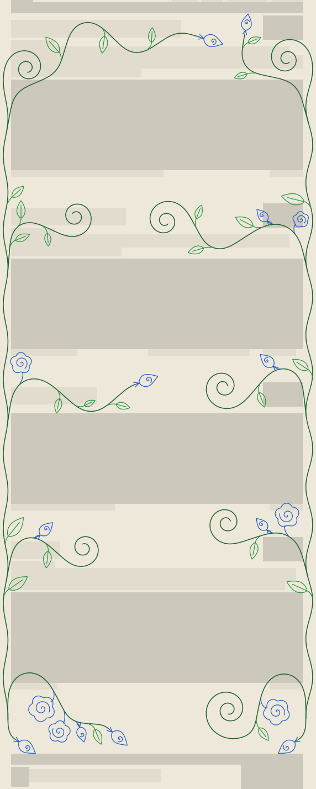

# stitch-vines

Grows a plant-like vine background (margin vines, branches, leaves, roses, buds and golden-ratio spirals) in the empty space of a web page, by rules, so the same look works on any layout.

## What it is

- `src/vine-grow.js`: the generator. Give it a description of the page (where the text, cards, buttons and headings are) and it returns polylines. It draws nothing itself: render the polylines as cross stitches, SVG, canvas or anything else.
- `src/page-adapter.js`: the page adapter. A browser script that measures a live page (text lines, cards, images, buttons, headings, header and footer lines) and builds the layout description the generator needs.
- `demo/`: a small generic demo page. `demo/index.html` measures itself, grows the vines and draws them behind the content as cross stitches.
- `tools/record-layout.js`: opens any URL at a width in a headless browser, runs the adapter and saves the layout as a recorded layout for the checker.
- `tests/check.js`: an automatic checker. It measures every rule on the generated vines (no touching, no bend tighter than 6.5 stitches, branches that leave their parent tangentially, and so on) and fails when one is broken.
- `docs/rules.md`: the rules, in plain words with their numbers. This is the instruction set.
- `docs/layout-contract.md`: what a page has to supply.
- `docs/roadmap.md`: what is missing.

Every limb is one continuous stroke grown step by step from its curvature. Nothing is cut after it is drawn, so there are no stubs, kinks or floating leaves.

## Try it

Needs Node 18 or later. The generator, the adapter and the checker have no dependencies.

    node tests/check.js            # runs the generator on 5 recorded layouts and checks the rules
    node tools/render-svg.js 910 out.svg   # draws a layout with its vines as an SVG

See the demo in a browser (any static server will do):

    python3 -m http.server 8765
    # then open http://localhost:8765/demo/index.html   (add ?mask to see what the adapter measured)

The page shows first; the vines are grown in a background worker (about 1 to 3 seconds on the demo) and drawn when ready.

Use it on a page of your own: load `src/vine-grow.js` and `src/page-adapter.js`, then

    const ctx = StitchVinesAdapter.measure({ headings: 'h2', cards: '.card' });
    const polylines = window.StitchVines(ctx);       // then draw them (see demo/render.js)

Turn any live page into a recorded layout and check it (needs Playwright, a dev dependency used only by this script: `npm install`, then `npx playwright install chromium`):

    node tools/record-layout.js https://example.org/ --width 700,910,1440,1920 --name mysite
    node tests/check.js mysite-910 mysite-1440

## Status

Honest list of what is true today (all measured on 30 Oct 2026):

- **The adapter works on the demo page and on a copy of it with different class names** (selectors passed as options). It has **not** been tried on any real website yet.
- The demo page was recorded at 700, 910, 1024, 1440 and 1920 px wide. The geometry checks (1 to 11) pass on all five, and on the five older recorded layouts. The composition checks (12 and 13) warn: at 700 and 910 px there are no branches and no rose in the space above the footer; at 1024, 1440 and 1920 px there is one branch a side there, not two or three.
- **The generator is picky about the page.** The demo page had to be shaped to suit it: a first section with room above its first row of cards, and a footer whose left and right corners are empty just below its top line. When a margin vine cannot be placed the generator returns no vines at all (and the checker then reports "pass" on zero vines; see `docs/roadmap.md`). The adapter says nothing about this yet.
- The adapter assumes sections made of a heading followed by a row of cards or images, equal side margins, and content that does not scroll sideways. Other layouts are roadmap item 4.
- Generation takes about 1 to 3 seconds on the demo, in the checker and in the browser. It is run off the main thread in the demo so the page stays usable.
- The demo was looked at in one browser (the Claude app's built-in Chromium) at 910 and 1440 px. Other browsers and phones are untested.

## Licence

MIT, see `LICENSE`.
