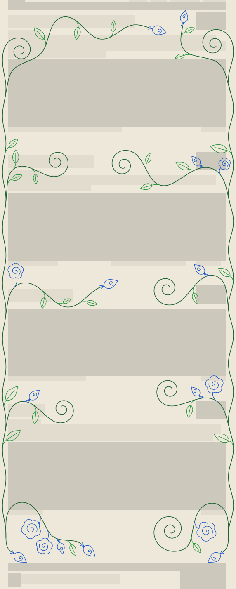

# stitch-vines

Grows a plant-like vine background (margin vines, branches, leaves, roses, buds and golden-ratio spirals) in the empty space of a web page, by rules, so the same look works on any layout.

Made with Claude.

## What it is

- `src/engine.js` + `src/planner.js` (joined by `npm run build` into `dist/vine-grow.js`): the generator. Give it a description of the page (where the text, cards, buttons and headings are) and it returns polylines. It draws nothing itself: render the polylines as cross stitches, SVG, canvas or anything else.
- `src/page-adapter.js`: the page adapter. A browser script that measures a live page (text lines, cards, images, buttons, headings, header and footer lines) and builds the layout description the generator needs.
- `demo/`: a small generic demo page. `demo/index.html` measures itself, grows the vines and draws them behind the content as cross stitches.
- `tools/record-layout.js`: opens any URL at a width in a headless browser, runs the adapter and saves the layout as a recorded layout for the checker.
- `tests/check.js`: an automatic checker. It measures every rule on the generated vines (no touching, no bend tighter than 6.5 stitches, branches that leave their parent tangentially, and so on) and fails when one is broken.
- `docs/rules.md`: the rules, in plain words with their numbers. This is the instruction set.
- `docs/layout-contract.md`: what a page has to supply.
- `docs/roadmap.md`: what is missing.

Every limb is one continuous stroke grown step by step from its curvature. Nothing is cut after it is drawn, so there are no stubs, kinks or floating leaves.

## Try it

Needs Node 18 or later. The generator, the adapter and the checker have no dependencies.

    node tests/check.js            # runs the generator on 5 recorded layouts and checks the rules
    node tools/render-svg.js 910 out.svg   # draws a layout with its vines as an SVG

See the demo in a browser (any static server will do):

    python3 -m http.server 8765
    # then open http://localhost:8765/demo/index.html   (add ?mask to see what the adapter measured)

The page shows first; the vines are grown in a background worker (about 1 to 3 seconds on the demo) and drawn when ready.

The demo has a style switch (bottom right, or `?style=charcoal` in the address): cross stitch, charcoal, zentangle and quilling. Changing style redraws the same vines. Cross stitch and charcoal are looks given to the vines as they are. Zentangle and quilling are *inspired by* those arts, drawn on the same vine shapes; a real zentangle (pattern fills) would need its own generator. This is an experiment to decide a direction, not a finished feature.

Use it on a page of your own: load `dist/vine-grow.js` and `src/page-adapter.js`, then

    const ctx = StitchVinesAdapter.measure({ headings: 'h2', cards: '.card' });
    const polylines = window.StitchVines(ctx);       // then draw them (see demo/render.js)

Turn any live page into a recorded layout and check it (needs Playwright, a dev dependency used only by this script: `npm install`, then `npx playwright install chromium`):

    node tools/record-layout.js https://example.org/ --width 700,910,1440,1920 --name mysite
    node tests/check.js mysite-910 mysite-1440

## Status

Honest list of what is true today (measured 30 Oct to 13 Nov 2026):

- **Text stays clear by default.** The adapter marks every line of text and the generator keeps vines at least a stitch away from it (rule 12b, checker 12t). Only with `textClear: false` may vines pass under words, and then the adapter warns when a vine colour fails WCAG contrast against the page's text colour. With the demo's own text colour the contrast is 1.03:1 for charcoal, 1.2:1 for zentangle ink, 2 to 3.8:1 for the cross-stitch colours and 2.9 to 6.7:1 for quilling, so charcoal and zentangle must never sit under words.
- **The demo page works.** Recorded at 700, 910, 1024, 1440 and 1920 px with text kept clear: geometry checks 1 to 11 and 12t pass at all five. The composition checks (12, 13) warn: only the right-hand side gets branches between sections (none on the left, where the text sits), and 700 and 910 px get no branches or roses in the space above the footer. The older recording (vines may pass under words) passes 1 to 11 as well.
- **The demo had to be shaped to suit the generator:** about 150 px of empty space above the first heading (the left margin vine's top spiral needs it once text is blocked), room above the first row of cards, and empty footer corners. When a margin vine cannot be placed the generator returns no vines at all, and the checker then reports "pass" on zero vines (see `docs/roadmap.md`).
- **Real websites: it did not work on any of the three tried.** (a) A long encyclopedia article: 24 px side margins at 910 px (3.7 stitches, too narrow for margin vines) and an off-centre column at 1440 px (264 px left, 44 px right); only 3 of 8 headings are followed by images. No vines. (b) A story-card grid: no section headings (the titles are `h3`/`h4` inside cards, not above rows) and at 910 px no side margin at all. No vines. (c) A shop page that scrolls inside inner containers, so the document is only 900 px tall and the adapter cannot see the real page. No vines. These are limits of the adapter and of the "heading plus row of cards" assumption, not of the pages.
- Generation takes about 1.5 to 5 seconds on the demo; it is run off the main thread in the demo. On the 14,000 px article the generator needed 4 to 5 seconds just to say it cannot place margin vines.
- The demo has four looks: cross stitch, charcoal, zentangle (inspired) and quilling (inspired). Looked at in one browser (the Claude app's built-in Chromium) at 910 and 1440 px.

## Licence

MIT, see `LICENSE`.
